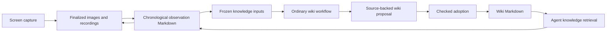

# Capture evidence and knowledge workflows

Screen capture should use the same files, properties, links and workflow model
as other knowledge work. Media viewers are generic file viewers. An index or
summary is an ordinary Markdown document, not a second source of truth.

## File representation

A session has one chronological UTC folder:

```text
captures/2026-10-25/01-23-43--<session UUID>/
  recordings/01-23-44--000000.webm
  images/01-23-45.457--<frame UUID>.jpg
  observations/01-23-44--000000.md
```

Each observation note covers one finalized recording interval, contains full
stored visual descriptions in chronological order, embeds relative image links,
and links the original recording. A failed transcription retains the image and
an explicit failure description. A note contains at most 32 observations and
1.5 MB of UTF-8 source; overflow refuses publication rather than truncating.

Frontmatter records document identity, source kind, owner, session, interval,
and each asset's canonical content identity and size. These are ordinary inert
values, preserved by the Markdown codec. `source-kind` alone does not install a
canonical Simmis type. Trusted Screenshot/Recording type definitions can bind
these values through the existing typed property mechanism; UUID strings must
not be inferred to be database references.

The legacy capture path timestamps screenshots when the server receives them.
Recording offsets have a separate client timing anchor. Notes label these as
server receipt times and *estimated* recording positions. They represent stored
sampled observations; they do not certify that every accepted frame completed
inference or that all events share an exact capture clock.

## Publication boundary

Completed archive export is an explicit owner operation into the owner's
personal workspace. Partial screen-sharing permission does not authorize
exporting a whole recording to a shared room.

Before native file creation, inspect the legacy bytes with finite stream
bounds, verify their legacy SHA-256 and canonical logical content identity, and
copy them into the original App's private immutable cache. The original App
operation owns that cache borrow until native consumption returns. Native file
creation uses the normal room effect, quota, expected-worktree and commit
completion path. Client-facing APIs never accept or return host file handles.

Publish assets before the note that refers to them. An existing asset can be
accepted only after exact identity, size, mode and byte verification; this is
an observation of current availability, not recovery of a lost native commit
acknowledgement. A pending native operation stops the batch. It must not be
replayed or silently described as successful.

Source metadata, target files and publication claims live in separate stores.
There is no cross-store atomic transaction or rollback claim. User edits are
preserved by compare-and-write rather than overwritten by an importer.

## Wiki integration



The knowledge selector already admits Markdown only, with finite file and byte
limits. Adding `captures` as a trigger root therefore selects observation notes
without loading image or video bodies into the model prompt. Existing inbox,
meeting transcript and wiki context sources remain part of the same workflow.
Adopted wiki output is context, not a new evidence trigger.

The shipped workflow still needs an explicit versioned source update and tests
before capture notes become default inputs. Long capture histories also need a
bounded backlog/cursor policy; raising limits to ingest an entire archive is
not the intended solution. Updating the shipped workflow must preserve users'
edited workflow files and must not enable schedules or provide funding.

A useful benchmark must require a substantive wiki change with precise source
citations, distinguish conflicting observations from established facts, retain
existing page/block identities and properties, and ensure binary media and
unselected/private evidence are absent from the frozen inputs. A no-op is valid
when no change is supported, but cannot stand in for the positive benchmark.

## Retrieval and later computer use

Text search should find a wiki claim and its observation note. The note provides
an exact image identity and an estimated video position to inspect. Image access
still requires current room authority; a content hash or wiki link is not a
capability. When visual verification is needed, the agent may request the linked
original image through an admitted vision tool/model rather than relying only
on a possibly mistaken description.

These files provide provenance and retrieval for later computer use. They do
not grant live screen access, input control or permission to act on instructions
appearing in captured content. A future continuous-capture publisher must first
persist accepted frame identities, use shared client elapsed time, seal a cutoff,
and join inference and recording finalizers before acknowledging completion.
The legacy immediate `finalizing` response is not that completion receipt.

## Implementation sequence

1. Generic media transport/viewers and source-preserving relative image/file
   rendering, with native browser verification.
2. Bounded source reads and explicit completed-archive export; assets before
   notes, current owner/room/default checks and honest uncertainty handling.
3. Capture inputs in the ordinary wiki workflow, source-backed positive
   benchmarks, and useful retrieval from the room.
4. Durable continuous-capture completion and bounded automatic publication.
5. Scheduled wiki maintenance with backlog handling, then explicit vision and
   computer-use affordances on top of the same evidence model.
