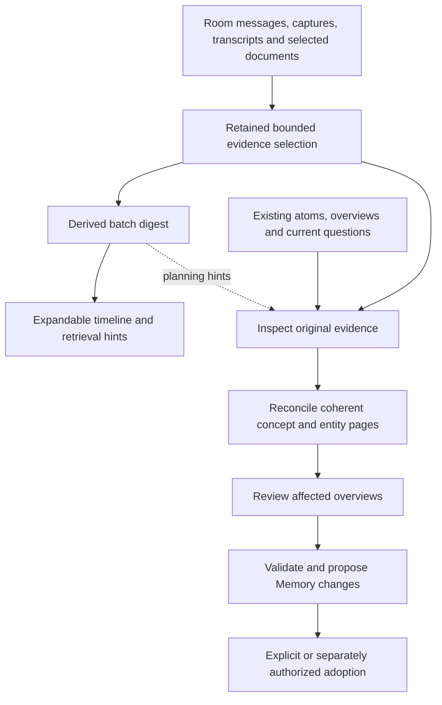

# Conversation digests and evidence-grounded knowledge maintenance

Status: implementation under local verification; not deployed. The current
slice includes bounded room ingestion before admitted workflow execution,
configurable destination policies, precise retained citations, and optional
digest Runs with explicit chat publication. Multilevel calendar summaries,
automatic digest generation and full-vault scaling remain future work.
It complements [the current wiki workflow](wiki-maintenance-workflow.md),
[incremental knowledge inputs](incremental-knowledge.md) and
[the document model](documents.md).

## Decision: native presentation, ordinary resource-controlled programs

Simmis owns conversation navigation, precise evidence links, expandable groups,
summary presentation and visible execution/coverage states. These affordances
must work without a model: dates, topics, counts, exact messages and manual
expansion remain available when no digest exists.

Model-generated digests use an ordinary shipped, editable workflow through the
existing Dvergr execution, provider, allowance and scheduling machinery. Wiki
maintenance is another ordinary shipped workflow. They may share evidence and
digest artifacts, and a maintenance invocation may prepare a missing digest as
an explicit bounded stage. There is no second provider client, hidden utility
spend path, scheduler or permanent wiki agent.

Shipping or installing source grants no resources and activates no schedule.
A room's authorized setup selects execution policy and finite resources using
the existing mechanisms. Subscription inference still consumes tracked usage
and dispatch allowance even when incremental billed dollars are zero. Record
actual usage/charges according to the provider and ledger contracts; do not
invent a monetary cost. Reading or expanding a summary never invokes a model.

## Independent paths over original evidence

The central invariant is that a digest is not an admission filter for the wiki.
Any admitted original message, transcript passage or capture observation can
support a knowledge update whether or not any summary mentions it.

Digest generation and wiki reconciliation have separate completion and progress
records. Neither a successful digest nor a completed Run means evidence has
been incorporated into the wiki. Digest failure does not make originals
ineligible; processing can continue directly when that execution is admitted.

## Scope, actors and target

A deployment binds the source Room, selected source kinds/ranges, destination
Memory, allowed knowledge locations/exclusions, exact workflow source, execution
policy and publication policy. The room's explicit default Memory is the initial
default; selecting another authorized Memory is additional scoped functionality,
not attachment-order fallback or automatic fan-out.

`wiki/` is a template convention. Imported Obsidian/Markdown repositories keep
their existing layout. Reading a repository does not install source, add IDs,
move notes or authorize editing configuration and attachments.

The room participant (for example Var) can coordinate the request. A workflow
worker is a separate task-scoped Run; it does not implicitly inherit that
participant's persona or conversation history. Its task receives an explicit
evidence selection. Requester/deployment authority, executing worker/model,
source author/speaker and adopting actor remain distinguishable in provenance.
The initial design needs no permanent maintenance identity. Agent selection
must not itself select a broader source scope or grant authority.

Manual chat invocation and schedules use the same saved program and admission
boundary. A schedule acts through its recorded creator and current authority;
cadence does not add access. Reading restricted evidence does not by itself
authorize publishing derived information into a more widely shared destination.

## Evidence selection and coverage

Collection is deterministic source capture, not an LLM summarization step.
Retain exact message identities, source store/Room identity, content revisions,
speaker, timestamps and available thread/causal references. Bound each snapshot
and record its actual selection and completeness. Stable ordering must handle
equal timestamps; a timestamp-only cursor is insufficient. Do not take the most
recent N messages and advance past an unprocessed earlier backlog.

Include human and relevant agent messages with attribution. Suggestions,
hypotheses, tool results and reported facts retain their different meanings.
Exclude maintenance's own routine status/digest notifications from automatic
fresh-evidence triggers; explicitly requested inspection remains possible.
Keep overlap/context distinguishable from new trigger evidence and deduplicate
by source identity/revision rather than text alone.

Capture observations retain the image's content identity, source session,
qualified timestamps and recording alignment. A generated description is an
interpretation, not the original visual evidence. Record whether the worker
inspected the image or only read its description. Original-image access uses
the existing authorized media/provider path. Neither every frame nor an entire
video is automatically submitted to a model. Capture export/source selection
must identify its destination explicitly; private personal recordings do not
silently become shared room evidence.

Every selected source unit needs an inspectable maintenance disposition:
incorporated (with affected page/claim references), already represented, inspected
with no change warranted, or deferred/unresolved. Bounded passages may subdivide
large units with recorded coverage. Uninspected, unavailable, oversized and
failed items remain explicit; they are not silently classified as irrelevant.
These records are model/workflow claims, not proof of exhaustive understanding.

Collection, digest preparation, maintenance proposal, no-op and adoption are
distinct states. Proposal creation does not advance adopted coverage. Accepted
changes finalize against the actual publication receipt; an explicit valid
no-op records its explanation. Deferred work remains visible and cannot starve
behind newly arriving evidence. Preserve existing incremental batch and held-
review semantics; do not add a competing cursor or acknowledgement authority.
Previously processed evidence remains retrievable and may be revisited when
new topics, corrections or workflow versions make it relevant.

## Digests and multilevel timeline presentation

### Daily activation and planned temporal aggregation

The original-evidence, optional manual digest and wiki-maintenance slice landed
in Simmis PR #162. The subsequent daily slice adds `summarize-room-daily` as an
ordinary editable workflow and a Room settings control. It is **off by default**;
loading source or reading this document enables nothing. Calendar rollups beyond
days remain planned; they are not provided by the daily workflow.

Expose an off-by-default daily summary setting in Room configuration, backed by
an ordinary saved-workflow activation and its existing creator authority,
timezone, model and finite resource policy. A cheap deterministic source check
must precede inference. No new eligible original revisions means no model call
and no new card; prior summaries, routine notices and workflow status cannot
make an otherwise idle room active.

The daily implementation uses the previous closed local day, skips empty or
unchanged originals before provider/resource preparation, and freezes up to two
prior ready summary heads as optional context. Its current bound is **64 originals
and 512 KiB of frozen input per day**, including context. Excess input holds the
activation visibly; it is never truncated into a supposedly complete day.
Batched completion of larger days remains follow-up work.

Room settings choose the daily time, IANA timezone, existing model and an optional
original-chat export. These controls point to the same ordinary activation shown
in Workflows. Off withdraws pending work and stops future admissions; running
work finishes normally. Configuration replacement is refused while the old run
is admitting or linked. It grants no resources: each active day is capped at
8 dispatches, 12 model steps, 180 seconds and 25,000 microdollars from the existing
shared Room allowance.

When enabled, original-chat export writes
`conversations/<room>/<day>.md` **before** model admission. Exact messages are
ordered by timestamp and kept in inert text fences. Its independently retained
projection intent survives inference failure. Native source transaction basis
orders replacements; an obsolete receipt cannot overwrite a newer transcript.
This records current public revisions at collection, not a full edit/deletion log.
It is an option on the daily activation, not an independent transcript daemon.

The Memory index `summaries/index.md` is an editable `simmis-view` document using
`{:kind :room-summaries :room :current}`. Its rows read native summary heads;
generated day files remain readable without the application or database. Native
publication attaches the Request pointer and schedule acknowledgments through the
existing control DB, whose private Memory change stream invalidates open views.
Readers recheck current Room access, source-store binding and full Memory target.
Retired Request payloads are not needed to read the summary’s retained originals.

The existing wiki workflow continues to select original evidence independently.
Generated `summaries/` and `conversations/` paths are outside its default trigger
roots. A customized wiki workflow can include selected summaries as context; the
shipped v6 workflow is unchanged and does not automatically load an unbounded
summary archive. Bounded native-summary context for wiki runs is follow-up work.

Keep two explicit, separately identified input sets:

- **Coverage:** the new original revisions or child-summary revisions whose
  activity this result summarizes. Only these establish progress for this node.
- **Context:** a bounded frozen selection of earlier summaries, open questions
  and relevant room/wiki framing. These help interpret the activity without
  becoming new evidence, independent corroboration or newly covered originals.

For a daily node, start with the previous available daily summary and a bounded
earlier overview when useful; sparse rooms need not have a summary yesterday.
Record the exact versions actually read. A context statement that an interview
is planned must not turn a new discussion into evidence that it happened.
Repeated decisions, changed proposals, corrections and resolved open questions
should be distinguishable in the output. Avoid a mandatory growing running
summary or copying all historical context into every new invocation.

All inputs are frozen before execution. Context must come from an earlier
immutable revision: a daily result cannot depend on a current all-time overview
that is itself waiting for that daily result. Future summaries may use the
completed overview revision. Store these versioned dependencies as an acyclic
graph; do not let a mutable filename define dependency identity.

Build day, week, month, year and all-time views from bounded lower-level nodes,
retaining transitive paths to exact originals. Calendar weeks straddle months,
so weeks and months cannot be a strict nested partition of the same days.
Use canonical daily coverage as the common basis for weekly and monthly views,
then aggregate months into years and years into an all-time overview. The UI
may offer either navigation grouping without counting overlapping coverage
twice. Every node records its timezone, interval and actual membership.

Higher-level summaries express themes, changes, outstanding questions and
contradictions, rather than concatenating child text. They can inspect relevant
originals through admitted source reads. A synthesized claim retains supporting
child/original references; uncertain claims do not become confirmed through
repeated aggregation. Historical snapshots remain immutable. An affected
current projection may be marked stale and revised, but unrelated history
should not be recomputed. Rebuild relevant ancestors under finite budgets,
prefer closed periods initially, and do not invoke models merely on expansion.
The all-time view must not rescan or regenerate the entire history each day.
If the calendar history outgrows a bounded parent input, use balanced interval
rollups beneath the presentation views rather than an unbounded list of years
or a perpetually rewritten running summary. Exact coverage union/deduplication
is deterministic; generated summary text is lossy and not associative. Record
the grouping and program/model identity instead of treating different reduction
orders as interchangeable computations.

Busy days require bounded batches with explicit partial coverage and remaining
work. The current eight-original manual digest contract is not a complete daily
aggregation algorithm; scheduling it over the first eight files would be wrong.
Deferred or unavailable originals cannot silently become a completed day.

Retain one logical summary identity with a structured execution result and
ordinary projections: a compact chat card and Markdown in the explicitly bound
default Memory, for example
`summaries/conversations/<room>/2026-10-30.md`. Native execution/publication
receipts remain authoritative for execution and delivery. Markdown revisions
are versioned documents, not another acknowledgement ledger. Summary folders
are derived context, excluded from automatic original-evidence triggers.
The wiki may use them to locate relevant topics, then inspect original evidence
independently; digest coverage never acknowledges wiki incorporation.

Use the existing saved-view abstraction for live summary indexes and tables,
with a new permission-scoped summary source adapter; current page/scorecard/
capture adapters do not already implement this source. Structured native
summary revisions are authoritative. Materialize readable Markdown bodies as
generated snapshots on successful publication, carrying the same summary and
revision identities, source references and projection version. A query-only
document is insufficient for Git and file-only workers. Indexes can be dynamic
while individual exported summaries remain ordinary readable Markdown.

Generated summary bodies are read-only in the normal editor. Users can copy
them into authored notes, add separate annotations or request a revised summary.
An external Git edit does not alter the certified native summary. Track the last
generated content identity so regeneration detects a modified projection rather
than silently overwriting it; surface that divergence for review. Authored
frontmatter alone never establishes generated ownership, authority or provenance.
Both native and document views identify the same logical summary so consumers
can deduplicate them. Datalog access remains an explicitly admitted capability;
file-only workers need no room-DB access. Original-source links retain the source Room's access checks. Generated Markdown
follows the destination Memory's sharing and Git settings: enabling export is an
authorized write into that explicit destination, not a new Room access grant.
Push or public-site publication retains its separate authorization.

Apply this hierarchy within each room first. A personal or organization-wide
cross-room overview is a separate explicitly scoped workflow with a separate
destination and current source permissions. Access to multiple rooms does not
authorize publishing their combined summary into every participant's room.

A digest is a versioned derived artifact over an exact source selection. It
records program/model identity and includes topics/entities, decisions,
proposals, observations, uncertainty, conflicts, open questions and supporting
source references. Its concise timeline text is one presentation, not its full
content. Human corrections are recorded revisions, not silent changes to an
historical generated artifact.

Chronological navigation can use month -> week -> day -> activity/topic ->
messages. Calendar grouping is presentation, not the ingestion batch boundary.
Sparse periods can skip empty levels; busy periods can expose topic/thread
groups. Threads may cross periods and references need not form a single tree.
Store exact interval/timezone and membership rules; display labels are not
source identity. Periods group messages; claims about later resolutions or
supersession must state their additional evidence basis.

Recent activity defaults to detail and older history may use coarser groups.
Expansion is local presentation state, preserves scroll position, and does not
mark sources read, processed or adopted. Manual expansions survive incoming
updates. A source link reveals the required ancestors and highlights the exact
message, with surrounding context and a return path. Virtualized/windowed
rendering is also needed; folding alone does not bound mounted history.

Higher-level summaries can consume lower-level digests but retain resolvable
support paths to originals. They must not turn repeated summaries into
independent corroboration. For material claims/conflicts, allow original
inspection rather than only recursive summary-of-summary generation. A changed
source or child digest invalidates the relevant derived basis; show stale,
partial, pending and unavailable states explicitly. Avoid recomputing all
history for every new message or generating anything on expansion.

Summary, source and current viewer authority must agree. A cached digest is not
a bypass for inaccessible or deleted source material. Historical citations and
source unavailability remain honest; do not substitute a current message/file
for the originally cited revision. The exact redaction/recomputation and durable
retention mechanisms require implementation design before automatic rollout.

## Precise wiki citations

A wiki claim can cite an exact message revision and optional passage, a source
document revision/heading, or a capture observation plus original asset identity.
A digest can be cited as synthesis, but is not equivalent to its primary sources.
Navigation precision and quoted-source provenance must survive timeline folding.

Adopted documents need usable persistent source links. Runtime paths such as
`/in/knowledge/sources/...` cannot be published as if they were portable vault
links. Preserve the frozen evidence basis in native provenance and provide
ordinary retained evidence files/links or meaningful external source references
for export. Cite stored evidence, not merely where a live website happens to
resolve now. If originals are unavailable, retain that limitation explicitly.

## Default wiki program: ground, reconcile, synthesize

Use Sam's actual generate/sync/lint specifications as process references, not a
new host subsystem. An atom covers one coherent concept or entity; claim-level
headings provide finer citation slots. Do not create a file per extracted
sentence. Reuse entities and aliases before creating duplicates.

Top-down requests establish framing, questions and coverage gaps. Bottom-up
ingestion reconciles source evidence with existing atoms. Classify changes as
strengthening, contradicting, extending, complicating, superseding or neutral
where useful. Preserve attributed disagreements and distinguish time-varying
facts from errors. New evidence need not force a single consistent narrative.

After atom changes, inspect affected overviews. An overview expresses a map,
relationships, synthesis, central tensions, uncertainty and outstanding work;
it is not just an index or copied atom text. Stages may alternate within one
Run. Larger work can later delegate through Dvergr when explicitly supported
and funded; independent permanent agents are not required.

The conservative default proposes Markdown creations/updates within configured
locations, preserving identities and metadata. Deletes, moves, broad link repair,
schema/configuration changes and attachment changes require separately scoped
operations. Retain existing exact-base review, preservation checks and normal
file proposal adoption. Accepting changes updates Memory; pushing to a Git
remote is a separate authorized operation.

Default scheduling and manual invocation share the program. No-change evidence
does not require an empty proposal. Current completion/capture certification
does not certify factual truth, and the authored benchmark checker is not
automatically executed by ordinary scheduled Runs.

## Existing implementations and convergence

### Runtime compaction and durable knowledge are separate

The reference study inspected OpenCode `5030a55f`, Codex `67f0994b` and
T3 Code `80a2351f`. Their bounded recent tails, explicit compaction boundaries
and original-message navigation reinforce the separation here: reducing a
model's active context must not erase evidence or acknowledge wiki processing.

[Dvergr #421](https://github.com/replikativ/dvergr/pull/421) applies the narrow
runtime correction: each new compaction marker records the exact original
message UUIDs it covers. Active-context projection removes only those covered
originals, preserving uncovered messages and protected recent tool-call/result
groups. Summarization input stays chronological, pruning recomputes tokens, and
threshold checks receive the selected model's context window. Historical markers
without explicit coverage retain originals rather than guessing coverage.

That compaction coverage identifies context replacement, not semantic truth or
knowledge incorporation. The digest contract below additionally distinguishes
represented, inspected-but-omitted and deferred originals. Wiki maintenance
inspects originals independently and records its own incorporation disposition.
Background compaction ownership, long-term summary consolidation and the full
calendar hierarchy remain separate work; the correction does not claim those.

- `agents/summarizer.clj` currently makes a legacy utility model call, writes a
  chat-summary page into an explicitly selected old KB, adds a timeline marker
  and invokes `agents/merger`. Its bounded recent-window selection and timestamp
  progress do not satisfy the evidence coverage contract above. Do not wire it
  into canonical Memory as a second automatic writer/spend path.
- `../simmis-whilo/src/is/simm/runtimes/notes.clj` used summary-generated links
  to select topics, but supplied original conversation text to note updates.
  Retain that separation while removing topic-summary gating and silent backlog
  loss. This is historical reference, not an integration dependency.
- Version 6 adds bounded original room activity collection before manual or
  scheduled admission, configurable vault destinations, exact source citations
  and per-original coverage dispositions. Native checkpoint execution,
  incremental batches, retained proposals and reviewed adoption remain the
  execution foundation. Version 5 source remains available unchanged for
  existing authored workflows. The calendar hierarchy above remains future work.

  Current intake excludes reserved private Run traffic (`:_runs`) and the
  non-subscribed activity/tool-visual stream (`:_activity`). These visual rows
  deliberately omit exact tool results and are not copied as originals. Publicly
  archived `:tool-result` evidence remains eligible when its author resolves to
  the canonical room party; a Run ID alone does not exclude a public original.
- Simmis SCI workflow helpers currently check authored source and return setup
  links/confirmation affordances; they are not a complete direct saved-workflow
  execution API. Legacy prompt/code scheduling remains distinct. Align actual
  prompt assembly and permission-checked actions instead of merely documenting
  an API that agents cannot use.

The proposed digest result needs a bounded host-validated contract. Common
navigation and evidence metadata should be interoperable; authored text and
workflow internals remain customizable. Publish derived files through existing
owned operations, and keep execution/adoption receipts in their native stores.
Do not add a parallel ledger, queue or global mutable cache. New UI state follows
Spindel execution contexts, ownership and cleanup; replicated metadata and existing
signals drive updates rather than a separate fetch/subscription framework.

Sam's `vault-wiki.zip` contains workflow specifications; the smaller
`030_Wiki.zip` contains 494 atoms and 65 overviews, with some cited original
sources absent. Imported fidelity hashes detect a specific body-drift baseline,
not factual truth or complete source verification. Preserve original unknown
metadata and unresolved links. The current 200-document canonical projection/
adoption bound is a known end-to-end limitation for that full export. Do not
claim support by raising a single limit or treating partial validation as full.

## Landing sequence and acceptance evidence

1. Define explicit room evidence/destination scope, exact source references and
   coverage contract. Reuse existing retained inputs, batch journals and authority.
2. Add bounded incremental chat/capture adapters and precise source navigation.
   Demonstrate one expandable batch/day digest with ordinary resources and no
   inference on read. Full calendar hierarchy can follow independently.
3. Adapt the editable default maintainer to original-evidence inspection,
   optional digest planning, atom reconciliation and affected-overview review.
   Generalize destination policy consistently across capture and adoption.
4. Connect chat authoring/invocation, benchmark and schedule actions to the same
   saved workflow kernel. Retire conflicting canonical/legacy instructions;
   preserve explicitly attached legacy stores until deliberately retired.
5. Verify on a small standard Memory and a root-level Obsidian-style repository,
   then perform a separately admitted finite model trial. Land focused changes
   with independent review. Scale projection/adoption together before full-vault
   rollout; do not wait for async frontend Datahike to implement the small case.

Required cases include a decisive single message omitted from a digest; a brief
company-site capture omitted from an hourly digest; no invented client
relationship; reused company identity; exact screenshot/message citations;
cross-batch corrections; duplicate timestamps; oversized/backlogged evidence;
unsupported/private sources; no-op; concurrent edits; stale digest/source;
preserved metadata; and interrupted execution/adoption without blind replay.
Compare direct-original and digest-assisted processing, measuring grounded
coverage, citation accuracy, atom/overview usefulness, false assertions, latency
and actual provider/resource usage. Distinguish deterministic checks from live
model quality. A disposition map is not itself evidence that coverage is good.

## Implementation verification

The default test suite makes no provider calls. The native regression in
`is.simm.ops.shipped-wiki-v6-daily-test` scripts only provider transport; it uses
real collection receipts, Request checkpoints, candidate execution, coverage,
review and adoption. Its next due occurrence must skip unchanged evidence with
no further dispatch, Job or resource movement. It also releases a real Request
retention root and verifies that current file bytes cannot replace the missing
historical snapshot.

`is.simm.ops.owned-room-evidence-test` covers source edits, unrelated appends,
claim and schedule races, uncertain recovery and a transcript backlog larger
than the retained-intent bound. `is.simm.ops.conversation-capture-test` keeps
public human, agent and tool-result originals distinct from private Run traffic,
activity visuals and native derived announcements.

The digest model, input, reader and notification tests check exact frozen bytes,
closed result structure, retained execution identity and non-replaying chat
publication. Browser lifecycle tests run through `npm run test:browser`.
Occasional separately admitted, finite subscription trials assess model behavior;
their success is not inferred from scripted-provider or deterministic checker
results. Reading, installing source and running the ordinary test suite never
enable schedules or mint execution allowance.

## Research references

- [Slack summaries](https://slack.com/intl/en-gb/help/articles/25076892548883-Guide-to-AI-features-in-Slack):
  summary citations preview/open source messages.
- [Zulip topics](https://docs.zulip.com/help/introduction-to-topics): explicit
  conversation organization complements chronological navigation.
- [Atomic evergreen notes](https://notes.andymatuschak.org/Evergreen_notes_should_be_atomic):
  coherent scope rather than indiscriminate fragmentation.
- [W3C PROV primer](https://www.w3.org/TR/prov-primer/): distinguish source,
  derivation, activity, agent and responsibility without requiring an RDF stack.
- [Obsidian internal links](https://obsidian.md/help/Linking%2Bnotes%2Band%2Bfiles/Internal%2Blinks):
  retain portable links while acknowledging application-specific block references.

These are design precedents, not proof that generated digests or wiki updates
are complete, factual or resistant to every misleading source.
