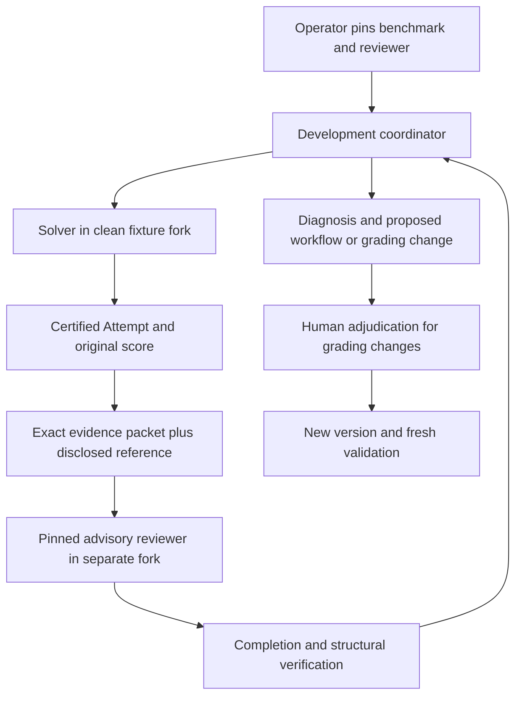

# Bounded recursive coordinators

`simmis_coordinator` is an explicit alternative to `simmis_task`, not a change
to ordinary file workers. It accepts the same task/model/finite limits and stable
request-id. It requires a work credential, current room membership and merge
authority, and an already provisioned native money/dispatch allowance. It never
funds itself or automatically merges into the room trunk. Existing credentials
retain their signed tool ceiling; mint a new work credential for the new command.
Identical retries check the original submission before resolving a model again;
changed submissions under the same request id are refused. Native startup
recovery includes coordinators: pointerless admissions become interrupted,
and terminal descendant wallets are reconciled without releasing held exposure.

The service uses the same work-request journal, Job, evaluation, Run and world
machinery as ordinary work. It offers only the Simmis completion verifier and
no world setups. Completion records execution, not task correctness; proposed
tests/checkers are not automatically promoted into trusted certification.

Inside SCI, `dvergr.agent/delegation-policy` lists the host's exact bounds.
Children may use only `#{:simmis/file-worker}` or `#{:simmis/coordinator}`,
the offered file/eval tools and accounted native providers. Combining profiles,
omitting a profile or requesting a broader tool/provider is refused before Run
admission. This policy and verifier scope follow recursive hires and experiment
cells. An experiment admits at most eight cells and parallelism two; these are
per-experiment ceilings, not a global CPU quota. Conserved grants bound aggregate
provider admissions and money across nesting.

The coordinator keeps the file worker's host registry, environment, mail and
room API restrictions. Only scoped composition functions are restored. World
effects still prohibit arbitrary hosts, processes, global writes and irreversible
publication. Ordinary workers remain unable to hire children. `agent/observe`
and `agent/cancel!` cannot target parent or sibling Runs from a child scope.

Results are available without an external orchestration script:

```clojure
(simmis.results/attempt-files attempt-id)
(simmis.results/attempt-file attempt-id {:path "/out/report.md" :offset 0 :length 16384})
```

These reuse the MCP/UI file projection over canonical immutable Attempt evidence,
including binary content/modes and base64 byte chunks. They do not copy file bytes
into another result store or reopen a discarded world. The reader accepts only
descendant Attempts certified by the explicitly offered completion verifier;
arbitrary verifier evidence and private fixtures remain inaccessible. Successful
reads record causal consumption on the parent Run. For other evaluators, the core
`agent/attempt-output` API reads only deliberately published `:agent/output` data.

This does not yet introduce pinned SCI AgentDef entrypoints, network research,
CLI recursive admissions, automatic checker promotion, process crash recovery or
deployment. The coordinator is still an LLM AgentDef whose Clojure tool programs
the shared harness; removing the need for that outer model is the next program
interpreter step. Capture transcription remains a separate room workflow.

## Saved composite workflows

A saved workflow can request the same bounded composition policy in
`workflow.edn`:

```clojure
{:title "Solve and critique"
 :profile "coordinator"
 :task "Read /inputs/case.edn. Hire a solver and an internal critic, then write /out/answer.edn."
 :capture ["/out"]}
```

The ordinary workflow and native benchmark admissions compile this declaration
through the same closed host profile. Existing developer workflows retain their
file-worker policy. A declaration requests capabilities; current room authority,
finite money/dispatch grants and native family admission still authorize every
execution. It does not give the workflow its own funding or merge permission.

A benchmark's composite candidate receives completion-only child verification,
separately from the private outer evaluator and fixture setup. An internal critic
is part of the measured candidate, including its cost and failures. It cannot
access hidden grading references. An independently calibrated grading workflow
is a separate evaluation of frozen answer evidence; completion alone never
establishes answer correctness.

Run ownership, wallets and causal records remain with the exact original control
Room even when the candidate forks a clean independent fixture. File and database
operations continue to use the selected working world. The native control owner
is ephemeral supervisor authority, never a serializable workflow input. Child
result consumption can be explicit: await the solver, then pass its returned
value or certified output to the critic's task. Neither child implicitly sees
its sibling's discarded files.

The source bundle and evaluation basis remain pinned together for an ordinary
MCP benchmark. Repeated admitted coordinator invocations may revise candidate
prompts and models against the fixed offer; this does not yet admit arbitrary
workflow-source revisions against an independently selected evaluation package.
Recursive CLI benchmarks and checkpoint-origin composite workflows are refused. This change adds no new scheduler or
automatic background execution.

## An inspected benchmark inside a coordinator

An optional `benchmark` on `simmis_coordinator` admits one existing owned
workflow as a fixed benchmark. Copy `expected-bundle` and
`expected-owned-source` from the same `simmis_workflow-check` inspection, and
supply finite candidate `limits`. Installation-operator status and room
read/merge authority are required for this custom checker admission.
Ordinary coordinators need no benchmark admission and keep completion-only
child experiments.

The coordinator's outer grant covers its own model calls and every child.
The declared workflow profile also selects the candidate sandbox: developer
requires `#{:simmis/file-worker}`, and coordinator requires
`#{:simmis/coordinator}`. Read the offered candidate profile before constructing
the candidate; broader requested tools or sandboxes are refused before profile
compilation.

Candidate limits are an aggregate ceiling for each invocation; they do not
provision funds. This first interface admits one candidate and parallelism one
per invocation. Compare prompt/model revisions by invoking it repeatedly within
the remaining parent balance. One physical gate is shared by the entire
coordinator family, including recursively hired coordinators; a concurrent
invocation fails as busy before resource allocation rather than multiplying
checker workers. The global checker permit and fresh fixture remain owned
until the outer native Job physically settles.

Inside the coordinator's SCI interpreter:

```clojure
(simmis.benchmarks/offered)

(let [team (dvergr.agent/make-agent
            (dvergr.agent/roster)
            {:id :candidate
             :prompt "My candidate instructions."
             :tools #{:clojure_eval :read_file :write_file :edit_file}
             :sandbox #{:simmis/file-worker}
             :model-policy {:provider :codex-subscription
                            :model "codex-subscription-luna-6"}
             :program {:kind :llm :max-model-steps 4 :auto-compact? false}})]
  (simmis.benchmarks/start!
    team {:resources {"microUSD" 20000M "model-dispatch" 4M}}))
```

Use an installed, admitted provider/model and a grant sufficient for the fixed
case set, within the benchmark's admitted ceiling and the current parent
balance. `start!` returns a receipt with `:job`, `:owner-run` and the exact
`:invocation`. Next call the model tool `await_child` with that Job UUID. It waits
in the supervised native worker, outside the SCI evaluation timeout, without
spending model turns on polling. It returns only after acknowledged native
settlement, with the exact Scorecard ID and up to 32 entries (`:next-offset`
continues the result). Save that ID and the conclusions in an `/out` report.

If a start response is lost, call `await_child` without a Job to list this Run's
admitted child receipts; follow `:next-offset` if present. Never start another
experiment merely to recover a missing response. Held cleanup, cancellation,
expired deadlines, incomplete results and missing settlement witnesses are not
successful benchmarks. A process restart does not resume a lost continuation.
The legacy Spin-returning `run!` remains available to explicitly managed code;
LLM coordinators should use `start!` followed by the native tool.

This await surface covers exact admitted invocation Jobs. It does not grant a
recursive candidate the outer private evaluator, nor general access to sibling
Runs. Completion-only child experiments keep their existing API.
Its entries use `:attempt/id`; `simmis.results/attempt-files` and
`simmis.results/attempt-file` read only captured `/out` files for descendants
certified by the exact admitted verifier. They never expose checker gold,
calibration or private setup evidence. Reads record causal consumption.

The host pins source bytes, source revision and target, selected dataset,
evaluator/setup references and policy in the original work request. Candidates
can change prompts/model choices; they cannot replace cases, tasks, checker,
setup, world parent or authority. Agent-authored checkers still need a separate
inspection and operator admission. This prevents an author from certifying its
own changed rubric merely by constructing another EnvironmentDef.

Candidate worlds fork a fresh fixture repository, rather than the author's
world or Git history. Run/Attempt records and all wallets remain in the original
control room; the returned Spin belongs to the coordinator's current context.
No second execution engine, billing ledger or automatic merge is introduced.
This interface currently accepts copied-fixture benchmarks; checkpoint-origin
benchmarks continue to require their separate native admission path.

An exact request retry observes the original Job before resolving current source
or model state. Restart recovery can retire only the original recorded fixture;
missing or uncertain ownership remains held. A failed physical gate release
keeps the child Job, result and parent acknowledgement pending until explicit
native recovery succeeds. Completion is still distinct from task correctness,
and benchmark results do not adopt proposed changes.

## Interpreting composite cost

The existing Scorecard `:spend` retains its historical receipt meaning. For an
LLM candidate it currently describes the root Run's model usage; it does not
establish complete solver/critic subtree or independent grading cost. Generated
composite reports state this limit, and coordinator instructions prohibit using
that field alone to select a cheaper composite. Do not replace it with wallet
allocations, returns or outstanding grants.

The control-store chat usage ledger retains observed per-model token quantities
after discard, so a dated diagnostic can inspect them independently of candidate
files. Missing provider dimensions/completeness information is not a known zero.
Durable own-Run measurements followed by a bounded, explicitly scoped subtree
projection remain the next accounting-observation step; existing immutable
Attempts and Scorecards must not be rewritten.

## Advisory review during benchmark development

An operator may additionally admit `benchmark.development-review` on the
coordinator request. This is an explicit **gold-aware development** mode,
requiring `benchmark.split = "development"` and:

```clojure
{:version 1 :data-use "exposed-development"
 :name "review-template"
 :expected-bundle inspected-review-bundle-uuid
 :expected-owned-source inspected-review-source-uuid
 :model "codex-subscription-luna-6@high"
 :limits {:budget-microdollars 200000 :max-dispatches 16
          :max-model-steps 16 :timeout-ms 240000 :settlement "discard"}}
```

Install the ordinary `benchmark-review` starter as that inspected template.
Its checker and executable calibration are mandatory. The operator pins the
reviewer source, prompt, model and maximum grant; the coordinator cannot supply
a replacement reviewer team, expected answer, checker or fixture. The parent
still pays from its one finite allowance. No review runs implicitly.

Reserve enough of the parent allowance for coordinator, solver and reviewer
calls; a written report followed by step exhaustion remains a failed execution.
The following is a finite example, not a validated default for every dataset.

After awaiting an exact benchmark child, the coordinator can request:

```clojure
(simmis.benchmarks/reviews-offered)
(simmis.benchmarks/start-review!
 {:subject {:job benchmark-job-uuid :scorecard exact-scorecard-uuid
            :attempt exact-attempt-uuid}
  :resources {"microUSD" 200000M "model-dispatch" 16M}})
;; Next use the await_child tool with the returned :job.
;; Then read /out/review.edn from that review's certified Attempt using
;; simmis.results/attempt-file. base64-decode is available in dvergr.codec.
```

The subject must be this coordinator's direct, completed and physically settled
child from the admitted benchmark. Native cell certification binds its exact
Job, Scorecard, Attempt, candidate, Environment and verifier. Only retained
source, reference, scoring contract and captured output enter the bounded
review packet. Source quotations refer to literal serialized fixture file text;
decoded EDN string spans and escaped file bytes are different coordinates.
The reviewer's expected packet comes from trusted setup evidence, never a
candidate-written expected-data file.

The reviewer is another native child experiment, awaited through the same
receipt path and sharing the benchmark's physical slot. It forks the clean
fixture parent rather than the coordinator's files or Git history. Neither
solver nor reviewer inherits benchmark/review offers. Both starts recheck
current human authority and the original Room incarnation. Causal edges record
consumption of the original Attempt. Native ownership, cancellation, cleanup and
resource settlement remain the existing Dvergr machinery.

The five public checks establish completion, output structure, packet/case
binding, exact source quotations and an advisory-only declaration. Failed
execution receives zero scalar reward while preserving individual structural
facts. These checks **do not establish diagnosis or legal correctness**. Validate
reviewer usefulness separately against frozen, independently reviewed examples,
including missing evidence, citation defects and plausible reference errors.

Captured advice may intentionally disclose reference information to the outer
coordinator. Clean sibling execution does not make subsequent tuning on these
cases blind or held-out. Preserve that exposed-development provenance, freeze
workflow revisions before fresh validation, and report structural conformance
separately from semantic quality. Reference or rubric changes remain proposals
for human adjudication; this API never promotes them, rewrites prior scores,
merges files or enables a schedule.



