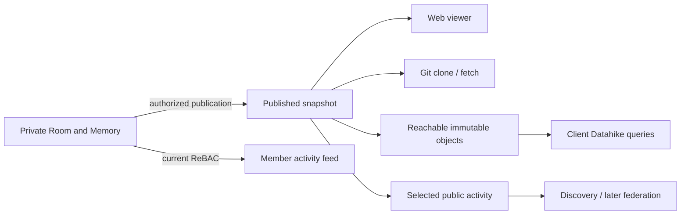

# Publication and collaboration

Planned extension of [semantic interfaces](semantic-interfaces.md). This is an
agenda and set of boundaries, not an enabled public API or connector. The
immediate campaign remains report consolidation, room-scoped chat results,
consistent external MCP handles, and bounded Git import/sync.

## One published source, several readers

A Memory can remain private, be shared with invited members, or publish a
selected snapshot. Room membership and public publication are different grants.
Public visitors never inherit an agent's or member's identity.

Use one explicit publication record to select the Memory, revision, included
paths/entities and history policy. Web pages, Git fetch and optional Datahike
access must agree on that selection. Publishing current files does not publish
private ancestors, deleted files, chat, proposals or speculative worlds. An
initial public Git repository can start with a fresh root containing only the
published files; preserving original history requires a separate reviewed choice.

The manifest identifies immutable files/media and pins their reachable objects
for the publication's retention period. Publish a prepared, validated root
atomically; readers must not observe a mixture of revisions. Source edits do not
change an explicit publication until a new revision is published. An optional
follow policy can automate that same checked operation. Unpublishing stops future
service access; it cannot recall downloaded Git objects, screenshots or caches.

Published HTML and media retain the Room-site script/origin isolation and safe
content-type/disposition rules. Publishing a Markdown attachment must not let its
scripts run with ambient Simmis credentials. Scope checks do not replace browser
content isolation.

### Datahike and Konserve

Read-only access prevents mutation; it does not establish which data may be read.
A backend credential for the original Konserve store may expose private index
nodes, historical values, blobs or configuration. Content hashes are identities,
not read capabilities. Key listing/existence probes also need an explicit policy.
Different backends provide different isolation guarantees.

Datahike HTTP permissions currently grant access at database/store scope;
branches share that permission boundary. Publishing one branch must not grant
access to the original private store. Public subset publication needs a separate
public projection and index root. Entity references, properties, search indices
and blobs must not pull private content into that projection.

Prefer a bounded immutable-object reader restricted to the published root's
reachable graph. A separate store/backend prefix can strengthen this boundary,
but a prefix alone is insufficient without validating its contents. No arbitrary
private-store key or branch selector should reach the reader. Limit object sizes,
bytes served and concurrent admissions. Publication roots are GC roots; define
retention for replaced publications and ongoing reads. Direct backend URLs need
equivalent scope and understood expiry/revocation behavior.

This can support lazy browser Datahike reads and flexible queries executed on the
reader's machine. It depends on async frontend store/query work; web viewing and
Git publication do not need to wait for it. Trusted whole-store sharing is a
separate mode when the entire store is intentionally shared.

Server reads can start with named, bounded queries over the public projection.
Datahike already restricts query function resolution and enforces server query
deadlines. Preserve those protections. Before broader public Datalog, verify
admission/concurrency, result-byte, traversal/work and cancellation limits too.
A timeout or read-only designation alone does not bound resource consumption.
A public general query endpoint is not needed for the first publication release.

## Invitations

Today Room settings adds existing accounts. Invitation acceptance and email
delivery need a distinct implementation; unrestricted self-registration is not
a substitute.

An invitation binds issuer, intended email/account, Room, allowed role and expiry.
Check the issuer's current grant authority at issuance and acceptance; revocation
or a narrowed role must prevent an old invitation widening access. Store a hashed
verifier for a single-use token, require the intended verified email/account,
and make claiming it with membership creation atomic and retry-safe. A new
account can be created through the invitation without opening public registration.
Do not incidentally grant installation admin, agent spending or tool permissions.

Start with a copyable invitation link, then email delivery through a bounded,
retryable outbox. Resending must not grant membership twice. Avoid exposing the
global email directory or revealing account existence in invitation responses.
No real invitation is sent by this plan.

## Activity and discovery

Extend the existing access-filtered feed rather than inventing a second activity
database with independent truth. Its page source still queries old wiki entities;
canonical Geschichte file changes and publication receipts need an adapter.
Stable event identity/provenance should come from committed events/receipts,
not rendering the feed or guessing an author from a path.

Useful first items: accepted proposals, published documents/sites, completed
workflow reports, review requests and mentions. Group related Run/tool activity
into an expandable summary linked to its actual source. Avoid a social post for
every autosave, screenshot or model step. Preserve drill-down and distinguish
incomplete/failed work from completed work.

Keep three audiences explicit: authorized member activity, instance discovery
of deliberately shared activity, and public/federated activity. Apply access
filtering before excerpts, counts, ranking, caches and notifications; revocation
must invalidate derived views. Private events must not leak via previews/totals.
Start with deterministic relevance from followed Rooms/people/topics, mentions
and work needing attention. Optional model digests can later be ordinary funded,
scheduled workflows; opening the feed must not itself start inference.

## External room media

Telegram already maps external venues/principals onto Dvergr Rooms. Reuse that
channel/medium contract for Slack and Discord, without new chat stores or agent
identities. Identity includes provider plus immutable workspace/guild and user
IDs; display names and email matches are not authority.

Each connection declares external channel, actual Room, inbound authority and
outbound audience. Account linking is explicit; external-channel presence does
not silently confer private Simmis membership. Preserve message/thread IDs,
provenance and edit/delete semantics. Use durable inbound deduplication and
retryable outbound delivery with loop prevention. Define access loss and offline
behavior. Mirror selected messages/files: external audiences and retention differ.

Slack is the first candidate for the founder/business audience, with Discord
following the same contract. Slack supports Socket Mode instead of an inbound
public webhook; Discord has a WebSocket Gateway. These need not expose private
Simmis MCP, but still require provider scopes/intents and outbound credentials:
[Slack Events API](https://docs.slack.dev/apis/events-api/),
[Discord Gateway](https://docs.discord.com/developers/events/gateway).

Public activity federation and private distributed Room execution are separate.
[ActivityPub](https://www.w3.org/TR/activitypub/) is an option for public activity
delivery. It does not supply private Room permissions, encrypted membership,
execution ownership or distributed index-space semantics. Do not replicate
speculative worlds or private backing stores as a shortcut.

## Delivery order and acceptance

1. Finish reviewed report publication and CI corrections. Return a compact result
   summary and scoped report link into chat; retain detailed jobs/attempts until
   ordinary document views cover their information.
2. Resolve MCP Room identity consistently; complete bounded Git import/sync via
   isolated preparation and checked advancement. Keep revision/conflict semantics
   without requiring users to operate a Git client.
3. Add invitation acceptance/link sharing. Verify expiry, replay, wrong account,
   revoked issuer and concurrent acceptance; then add email delivery.
4. Add opt-in public Memory viewing from a published snapshot. Verify excluded
   paths, private ancestors, references, media and cross-Room access. Add bounded
   clone/fetch from the same publication, then separately authenticated pushes
   into branches/proposals rather than public writes to live Memory.
5. Adapt canonical document/report events into the feed. Verify private previews,
   counts, revocation and cascade grouping. Public discovery uses deliberately
   published events. Add Slack, then Discord via the same Room adapter contract.
6. Evaluate published Konserve/Datahike reads when async browser access is ready.
   Prove reachability, snapshot consistency, GC retention, cancellation and
   admission limits. Named queries can precede a general public query API.
7. Add public activity federation, then private server-to-server Room/index
   sharing as distinct milestones with explicit authority and lifetimes.

These are adapters around the existing programming model. They need no new
state framework, feed-specific agent identity or public MCP.
