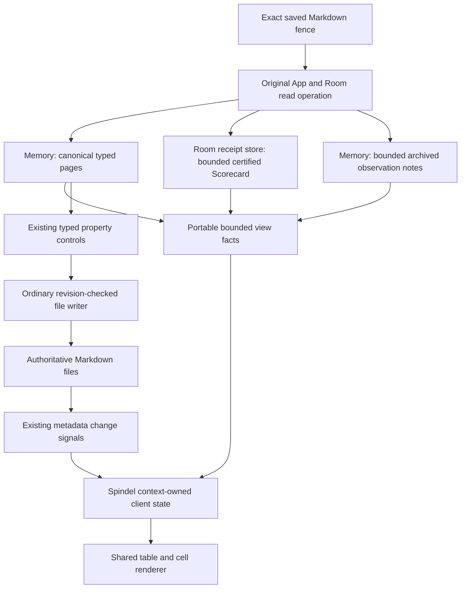

# Saved Markdown views

A Markdown document can contain a `simmis-view` fence describing a table of
source-backed pages. Opening its associated view reads the saved declaration;
the fence itself remains ordinary portable Markdown. Fixed sources support page tables/forms and saved benchmark Scorecards.

```simmis-view
{:version 1
 :id #uuid "270a88f9-e6da-4501-bdb1-86f3743bd224"
 :source {:kind :pages :roots ["companies"]}
 :presentation :table
 :columns [{:kind :title :label "Company"}]
 :order [{:kind :title :direction :asc}]
 :limit 50}
```

Add `:types [#uuid "..."]` to `:source` to require page types. Multiple types
mean all must be present. A property column is `{:property #uuid "..."}` with an
optional `:label`. These UUIDs identify existing type/property definitions;
they are not native database entity IDs. Ordinary source-owned properties are
supported; computed, reflected and component properties are excluded.

A form uses `:presentation :form`, `:limit 1` and `:page #uuid "..."` within
`:source`. Its page must belong to the selected folders and types. A missing
page produces an unavailable result rather than an apparently successful empty
form. Ordering currently supports the title in ascending or descending order,
with page UUID as a deterministic tie breaker. A plain frontmatter `title`
provides an optional display label (1–256 characters, no control characters).
Invalid or absent labels fall back to the filename. This label does not change
the page UUID, path, or path-owned canonical page title.

## Reading and editing

A valid view opens with its document by default. Hide view keeps it collapsed
until explicitly reopened in that editor; unavailable reads are not retried on
every render. The panel is an embedded host view, separate from editable text. A table's Edit
button loads the selected page's ordinary property form. Each field save uses
the existing revision-checked Markdown property writer, preserving document and
block identities. There is no multi-file transaction implied by editing several
rows. The page's Markdown remains authoritative.

Read permission is sufficient to inspect a view. Editing additionally requires
current write permission and current file/property definitions. A dirty source,
property or type draft in another tab, or a pending write there, prevents a
competing property write. Drafts are kept when a row moves or leaves a result;
the interface explains why editing is held.

The client refreshes from its existing metadata signals. A compatible result can
remain visible while it updates; replies for an earlier target, saved declaration
or metadata generation are ignored. Hiding and reopening a view obtains a fresh
read. A failed read offers an explicit retry rather than repeatedly issuing work
on every render.

## Boundaries and limits

Descriptors are inert bounded EDN, not executable queries. They cannot supply
functions, renderers, permissions or write commands. The server resolves the
exact saved file revision, fence span and view identity, enters the original
application/room lifetime, and projects one immutable authorized source. It
rechecks that room and source after native reads before returning portable facts.
No derived database or native entity handles cross into the response.

At most four declarations per document are mounted, each at most 16 KiB, with
16 columns and at most 50 page rows. For page sources the canonical projection bounds also apply:
200 Markdown files, 8 MiB of source and 20,000 worktree entries. Invalid selected
source produces an unavailable result, not a table built from partial data.
Narrowing folders can reduce read scope; property publication still uses its
existing canonical validation scope.

Cell previews are bounded independently of result completeness. Numeric values
are transported as text to preserve integer precision. Reference labels and
paths are exposed only for source-backed pages inside the selected projection;
other valid reference identities remain UUIDs. The view never expands arbitrary
native entity labels. These are preview limits, not changes to stored values.

The current frontend receives bounded file/projection reads rather than a full
canonical database replica. Future query adapters, media sources and
simulation components should reuse these source, lifetime and property-writer
boundaries. Arbitrary SCI evaluation on page opening is outside this contract.

## Saved benchmark results

The same fence can select one exact native Scorecard in the current Room:

```simmis-view
{:version 1
 :id #uuid "fc4ca343-c926-4050-8010-1b823654885a"
 :source {:kind :scorecard :room :current
          :scorecard #uuid "67b31691-aa8e-40d5-85d4-26661da87f4c"}
 :presentation :table
 :columns [{:kind :candidate} {:kind :attempts} {:kind :pass-rate}
           {:kind :pass-rate-interval} {:kind :cost} {:kind :notional-cost}]
 :limit 32}
```

Replace the Scorecard UUID with a completed result's content identity. This is
an immutable result selection, not a request to run or fund a benchmark. A UUID
never grants access, joins another Room or selects another store. The server
resolves the native store from the authorized Room; the browser matches its
reply against the Room's store identity in its existing membership roster.
The Markdown repository and the receipt store are separate sources.

Simmis workflow benchmarks keep records in their author/control Room. A
standalone Dvergr experiment may have a separate result Room; join that Room
through ordinary membership before viewing its records there. A result absent
from the current Room is unavailable, with no cross-Room search or fallback.

The fixed source reads a managed payload through Dvergr's bounded reader and
retains native certification and summary semantics. It does not load Attempt
receipts, resolve current workflow files, execute a query, or expose tools.
Its source does not scan the canonical page projection, so unrelated archived
Markdown files do not consume the page projection allowance for this report.
Read permission suffices; benchmark rows have no page property/edit bindings.

Supported column kinds are `:candidate`, `:attempts`, `:passed`, `:pass-rate`,
`:pass-rate-interval`, `:reward`, `:reward-interval`, `:cost`, `:notional-cost`,
`:cost-per-pass`, `:notional-cost-per-pass`, `:cost-known`,
`:notional-cost-known`, and `:usage-reported`. Optional labels are plain text.
Candidate order is the native leaderboard order. The display limit can show a
prefix without changing the complete matrix or recomputing any statistic.

Model cost is measured reported usage, not wallet consumption, outstanding
grants, forfeits, or a settlement certificate. Unknown cost displays a dash,
including unfunded runs with no priced usage. Known notional cost remains
visible independently. Native cost-per-pass is displayed without redefining
it. Recurring fractional currency values are marked approximate and rounded to
12 decimal USD places; integer microdollars and finite decimals retain their
exact decimal conversion. Extreme decimal scales are refused before expansion.

Native read ceilings are 4 MiB, 32 candidates, 4,096 matrix cells, 128
environments and 128 repetitions. The portable report has a separate 128 KiB
presentation ceiling. A complete certified matrix does not assert that its
parent job's accounting/adoption settlement has completed. Timing, nested model
attribution and pairwise tables require separate bounded adapters later.

## Archived screen observations

A read-only archive table can use one to four explicit session observation
folders. It reads the grouped Markdown notes already published into Memory:

```simmis-view
{:version 1
 :id #uuid "95640bdd-e16e-486f-a3f2-c45b0bac899c"
 :source {:kind :archived-captures
          :roots ["captures/2026-10-25/01-23-43--91359c37-d5a7-4771-a66c-7c3114a1b9a2/observations"]}
 :presentation :table
 :columns [{:kind :started-at} {:kind :until} {:kind :screenshots}
           {:kind :note} {:kind :recording} {:kind :alignment}]
 :limit 32}
```

Roots are exact archived session folders; `captures` alone is not a query.
Available columns are `:started-at`, `:until`, `:duration`, `:screenshots`,
`:note`, `:recording`, `:session`, and `:alignment`. Times are UTC and duration
is seconds. Rows sort by parsed time, then identity and path, including when a
session crosses midnight. The display may show a declared prefix of a fully
bounded selection; its total and incomplete-display message remain explicit.

The reader bounds raw prefix acquisition at 256 entries per root, the entire
selection at 128 notes, and all selected note bodies at 8 MiB before reading
them. Each note keeps the existing open-file limit and at most 32 screenshot
references. Overflow refuses the selection; it does not call the global
canonical page projection or silently sample an oversized archive. Source
changes during reading follow the same original-App/Room final checks.

Frontmatter identifies source evidence; it grants no access to the personal
capture store. These tables neither transcribe, publish nor fetch media bodies.
Screenshot counts show currently matching workspace files / referenced files.
A recording link appears only when its current path, content identity and size
match the note. Missing or replaced media shows as unavailable; opening any
link still uses the ordinary authorized media reader. Recording alignment
remains estimated. These source fields are conventions, not new editable type
or property bindings; observation text stays in its linked Markdown note.

## Source ownership



The diagram's shared renderer does not imply shared write authority. Page
properties use their existing writer. Scorecard and archive rows are read-only;
their data cannot install handlers or enroll page property controls. Recording
links retain their observed content UUID through the existing authenticated
media route, so a stale table refuses replacement bytes rather than silently
following its current path.

## Explicit Markdown snapshots

An opened ready view offers **Save Markdown snapshot** when the workspace is
writable. This is an explicit artifact operation, never part of rendering or
refresh. The client requires a current accepted reply and saves one new file
under `reports/snapshots/` through the ordinary owned file writer with an absent
expected destination. It does not change the source declaration or its rows.

The file contains a plain Markdown table and inert `simmis-snapshot` document
properties. JSON flow syntax inside YAML frontmatter records view/source IDs,
saved source entry and revision, display basis, selection and display limits,
row identities, declared columns, native matrix/provenance facts when present,
and explicit original-media path/content/size. Original links remain
application-relative and authenticated; exporting does not embed recordings or
publish access to them. Costs retain the same distinction between zero,
unknown, measured usage and wallet/grant accounting as the live presentation.
The file is a display snapshot, not another execution/adoption receipt or a
live `simmis-view` declaration.

Formatting has structural and cumulative text bounds before expansion and a
262,144-character final output limit. Overflow refuses export rather than
silently dropping rows. The client retains one pending destination and exact
bytes before dispatch. After an uncertain response, **Recover pending snapshot**
checks that same destination: exact existing bytes acknowledge the artifact,
confirmed absence permits the same absent-destination write, and different
content is never overwritten. Recovery keeps the original result even if the
live report changes. Nested reads/writes retain the initiating request token,
workspace epoch and operation ownership; a replacement context cannot continue
the old operation. Completion provides an ordinary file link and does not
navigate away from the user's current work.

## Document placement

Read mode places supported saved views at their exact fenced source positions,
including fences inside supported Markdown lists. The original declaration is
available through **Show source**, with its fence delimiters, language and
original line endings preserved. Display toggles live in the existing owning
Memory state and never edit the file or create a query/worker by themselves.
Opening the view continues to use its existing bounded source reader.

Correspondence pairs the actual parsed node kind/source span with its slot
model and nested content path. It does not search for matching code text.
Duplicate identities, invalid declarations, fences beyond the four mounted
entries, and unsupported structures do not borrow another fence's result.
Dirty or noncurrent source cannot receive an inline result from an older saved
version. Unplaced entries remain available in an explicitly labelled saved-
version section, with their ordinary source still visible in the document.

This is the Read-mode integration step. Rich and Outline currently keep their
existing separate panels. Rich-mode inline mounting must extend the existing
code-block node view, preserve its content DOM and selection/source mapping,
and explicitly release the Spindel subtree's refs and caches. It must retain
property drafts while correspondence is temporarily unavailable, and restore
rendered views only when the native/saved projection is verified again.


### Rich editor embedding

The default editor presents eligible saved views at their exact source fence,
using the same table/form component and Memory coordinator as Read mode. Native
code-block views retain their original contentDOM. The rendered island does not
enter Markdown, editor JSON or undo history; an editing selection/composition
reveals source, and **Edit Markdown** opens the complete fence in the ordinary
source view.

Placement requires clean, current saved-source and complete native-baseline
correspondence. Dirty or structurally changed documents expose literal source
and retain an explicitly labelled saved-version fallback. This first bridge does
not follow arbitrary unsaved structural edits by matching code text. Original
UUIDs, read/write checks, property drafts and request ownership stay with Memory.

Parent Spindel updates provide the latest presentation callback; the native
bridge adds no data cache, query or subscription. Every native mount has an
isolated context/fork/owner/occurrence address. Callback refreshes are coalesced
and fenced to the original editor generation. Removal cycles ref callbacks,
retires committed addresses, clears the discharge registry and removes DOM.

## Report source plans

`is.simm.documents.benchmark-reports/prepare` formats a complete, already
authorized native Scorecard into two ordinary Markdown source plans:
`reports/benchmarks/<scorecard-id>.md` and `reports/index.md`. The report
contains the fixed Scorecard view and frozen experiment, dataset and available
workflow provenance; the index is a page view rooted at `reports/benchmarks`.
Numbers are read from the native receipt when the view opens, rather than
copied into a second result authority. Save Markdown snapshot remains the
portable export when another instance does not hold that receipt.

The formatter is pure and does not publish files or select a Memory. Its caller
must authorize the native read and retain the original Room/store identity. A
future product publisher must also capture its owned Memory target, use the
ordinary expected-revision writer, preserve authored files, and reconcile exact
prepared bytes after a lost acknowledgement. Generating or opening a report
does not run a model, enable a schedule, or accept a proposal. The current
formatter is groundwork; no automatic report publication is installed here.
